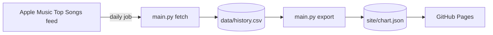

# Trending Songs Finder

[](https://github.com/kennethkimbrough/trending-songs-finder/actions/workflows/tests.yml)

Tracks a music chart over time. Once a day it records Apple Music's Top Songs
chart for the US, adds it to a history, and reports what entered, what dropped
off, what moved, each song's peak position and how many days it has lasted.

**Live page:** https://kennethkimbrough.github.io/trending-songs-finder/ is
rebuilt from the history after every daily run.

## What it does

`fetch` reads the current chart and stores it as one run: up to 100 songs with
their position, artist, genre, release date and link. The default source is
Apple Music's public Top Songs feed, which needs no account or key.

`report` compares the latest run with the one before it:

```
Run 12 fetched 2026-11-10T14:41:07 (apple, US), 100 entries

Compared with run 11 (2026-11-09T14:41:02)
  entered the chart: 4
    #23  <song> by <artist>
    ...
  dropped off: 4
    was #87  <song> by <artist>
  biggest moves: 61 changed position
    +18  #41  <song> by <artist>
    ...

Staying power over the last 5 runs
    5 runs  <song> by <artist>
    ...
```

`export` writes `site/chart.json` for the page: today's chart with each song's
movement, peak, days on the chart and its positions over the last 30 days, plus
the songs that dropped off.

`fetch --dry-run` prints the chart as a table and stores nothing.

## Where the data comes from, and why not Spotify

The project started on Spotify's Web API. Spotify restricted its
Recommendations endpoint to existing apps in November 2024, and in February
2026 removed New Releases (and other browse endpoints) from Development Mode
apps altogether, while also requiring the app owner to have Premium. A new
developer app can no longer read either list.

So the default source is now Apple Music's Top Songs feed
(`rss.marketingtools.apple.com`), which is public. The Spotify code is still
here as `--source spotify` for apps that have extended access; it stores the
same row shape (with the album as the item).

## How it runs



- `.github/workflows/daily-chart.yml` runs every day: it fetches the chart,
  appends it to `data/history.csv`, writes `site/chart.json`, puts the text
  report in the run summary, and commits both files.
- `.github/workflows/pages.yml` publishes `site/` after each daily run.
- `.github/workflows/tests.yml` runs the tests on every push.

The history is a plain CSV so that each day's commit is a small text diff.
MySQL is still supported for anyone who wants the data in a database
(`STORAGE=mysql`, tables in `schema.sql`).

## Run it

Requires Python 3.10+.

```sh
pip install -r requirements.txt
python main.py fetch --dry-run              # print today's chart
python main.py fetch                        # store it in data/history.csv
python main.py report --runs 5 --top 10
python main.py export                       # write site/chart.json
(cd site && python3 -m http.server 8000)    # look at the page
```

Options: `--market GB` (or `CHART_MARKET`) changes the country; `--limit`
(or `CHART_LIMIT`) caps the entries per run; `--source spotify` uses Spotify
with `SPOTIFY_CLIENT_ID` and `SPOTIFY_CLIENT_SECRET` set.

To store runs in MySQL instead of the CSV file:

```sh
mysql -u root -p -e 'CREATE DATABASE dbspotify'
mysql -u root -p dbspotify < schema.sql
export STORAGE=mysql DB_HOST=localhost DB_USER=root DB_PASSWORD='' DB_NAME=dbspotify
python main.py fetch
```

With Docker, the image runs `fetch` by default:

```sh
docker build -t trending-songs-finder .
docker run --rm -v "$PWD/data:/app/data" trending-songs-finder
docker run --rm -v "$PWD/data:/app/data" trending-songs-finder report
```

## Tests

```sh
python -m unittest discover -s tests
```

The tests mock the HTTP client and the MySQL driver, so they need no network,
credentials or database: parsing both feeds, the CSV history (round trip,
quoting, run ids), the SQL issued for MySQL, the diff and staying-power
calculations, and the summary the page is built from (previous position, peak,
days on the chart, position history, drop-offs). The MySQL tests are skipped
when the driver is not installed.

## Layout

```
main.py             command line: fetch, report, export
apple_music.py      the Apple Music Top Songs feed and its parsing
spotify_api.py      Spotify auth, New Releases and parsing (for apps with access)
database.py         storage: save_run, load_runs, over a CSV file or MySQL
report.py           pure functions: diffs, staying power, the page summary, text formatting
config.py           settings from environment variables
schema.sql          the MySQL tables
data/history.csv    every recorded run (written by the daily job)
site/               the page: index.html, app.js and chart.json
tests/              unittest + mock
```

## Tech stack

Python, `requests`, `csv`, `mysql-connector-python` (optional), `unittest`,
Docker, GitHub Actions, GitHub Pages.

## Data

Chart data comes from Apple's public marketing feed and remains Apple's; it is
used here for personal, non-commercial tracking.

## License

MIT (code only)
